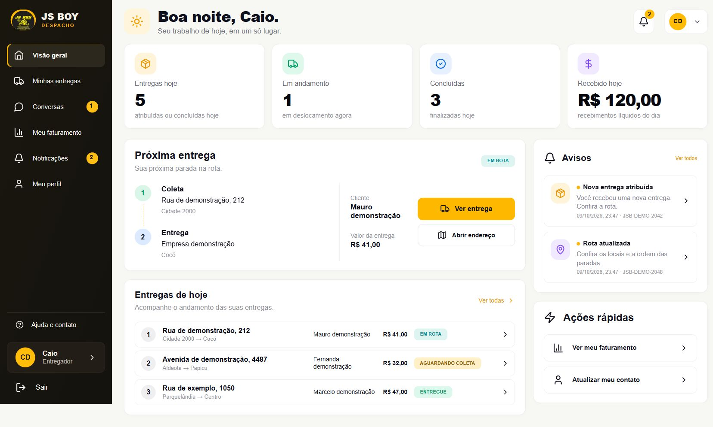
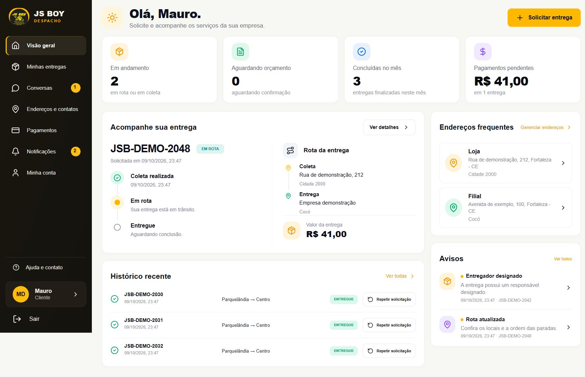

# Correção visual dos portais — referências de 09/10/2026

As visões gerais do entregador e do cliente foram reorganizadas conforme as duas
imagens reenviadas pelo responsável. A conferência foi feita no navegador, com a
aplicação React real e uma API local de demonstração. Todas as pessoas, entregas,
valores, contatos e notificações nas capturas são fictícios.

## Estrutura implementada

- Sidebar escura de 260 px, marca existente, seleção amarela, ajuda, perfil e saída.
  Conversas permanece disponível conforme o plano funcional original.
- Cabeçalho único, fundo claro, quatro indicadores e cartões brancos com as cores,
  ícones, espaçamentos e hierarquia das referências.
- Entregador: próxima entrega com rota ordenada, cliente, preço e ações; três
  entregas do dia na prévia; avisos e ações rápidas na coluna direita. O endereço
  abre a primeira parada ainda não concluída, inclusive em rotas com mais de dois locais.
- Cliente: botão de solicitação no cabeçalho; acompanhamento com timeline e rota
  lado a lado; histórico com repetição da solicitação; endereços e avisos à direita.
- Em celular e tablet, os blocos se reorganizam e os indicadores passam a duas
  colunas. Foram preservados os estados de carregamento, erro e ausência de dados.

## Indicadores e contratos

“Recebido hoje” usa o novo campo aditivo `valorRecebidoHoje` do resumo operacional:
recebimentos menos estornos realizados no dia em America/Fortaleza, do recebedor
registrado no lançamento e vinculado à conta. O preço dos serviços concluídos
continua em `valorMovimentadoHoje`. Se a API ainda não fornecer o novo campo, a web
mostra “Valor movimentado hoje” com a descrição correspondente.

O cliente conta conclusões no mês da operação e mostra o saldo pendente e a
quantidade de entregas com saldo. Números e status vêm dos dados da API; as imagens
de referência não foram usadas para fixar resultados. Avisos correspondem a
notificações existentes e levam à entrega/conversa associada.

Nenhuma migration foi criada ou modificada. A operação mantém recebimento manual,
Pix direto, dinheiro, finalização condicionada ao saldo e às paradas, sem foto/OTP.
O trabalho móvel Flutter e as alterações locais preexistentes foram preservados.

## Validação local

- Web: 51 testes em 17 arquivos passaram; build TypeScript/Vite passou.
  Após a revisão final de componentes, cinco testes de portais/conversas passaram.
- API: `mvn verify` com Java 21 passou — 147 testes unitários e 53 de integração,
  usando PostgreSQL 16 em Testcontainers e diretório de build isolado.
- A nova consulta foi exercitada com recebimento parcial, integral e estorno,
  limites do dia, outro recebedor, lançamento legado e mudança da atribuição atual.
- Navegador: conferência visual em 1672×941 e 390×844 para ambos os perfis;
  cliente também em 1440×900 e 768×1024. Sem transbordamento horizontal nas
  verificações móveis. Nova solicitação abriu o formulário e Minhas entregas
  recebeu a seleção da entrega. O menu móvel fechou ao navegar.
- Revisão: estilos exclusivos para o novo acompanhamento evitam interferência na
  timeline do rastreamento público; autorização e ações operacionais existentes
  foram reutilizadas. O Vite mantém o aviso de bundle acima de 500 kB.

Esta validação local não equivale a homologação ou publicação em produção.
Não houve push, deploy ou alteração manual de dados reais.

## Capturas

### Entregador

[Captura do entregador no celular](evidencias/portais-2026-10-09/entregador-celular.png)

### Cliente

[Captura do cliente no celular](evidencias/portais-2026-10-09/cliente-celular.png)
